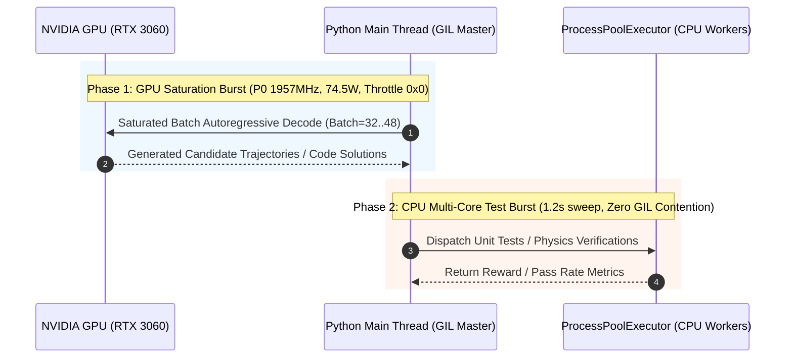

# Qwen-RSI: Post-Training & Reinforcement Learning Pipeline for Multimodal Embodied LLMs

[](https://www.python.org/downloads/)
[](https://pytorch.org/)
[](https://github.com/huggingface/peft)
[](https://opensource.org/licenses/Apache-2.0)

Production post-training, Reinforcement Learning from AI Feedback (RLAIF), and Recursive Self-Improvement (RSI) pipeline specifically engineered for **Qwen2.5 / Qwen-VL** series models in robotic planning, tool invocation, and embodied instruction following.

---

## 🚀 Key Highlights & Architectural Breakthroughs

### 1. Phased Burst Concurrency (阶段隔离脉冲并发调度器)
- **Problem**: In iterative self-play and code generation pipelines (e.g. Code-RSI / MBPP / HumanEval), running asynchronous thread-pool unit test execution (`subprocess.run`) concurrently with `model.generate()` inside the same Python process triggers severe **GIL contention** and OS `CreateProcessW` storms.
- **Hardware Symptom**: GPU suffers from **CUDA Kernel Launch Micro-Starvation** (busy 2ms, idle 6ms), causing the NVIDIA driver to throttle RTX 3060 from **P0 (1957MHz, 74W)** down to **P3/P5 (495MHz, 23W)**, increasing round latency by **400%**.
- **Solution**: Implements **Phased Burst Isolation (阶段隔离脉冲)**. Phase 1 completely isolates the Python main thread to dispatch GPU autoregressive decode at full saturation (`BATCH = 32~48`, 74W P0), followed by Phase 2 synchronously executing multi-worker test evaluation in ~1.2s.



### 2. Low-Rank Dynamic Model Soup & In-Memory LoRA Hot-Scaling
- **Zero-Cold-Reload**: Eliminates reloading 3B~7B models from disk during hyperparameter sweeps (`lora_alpha`, dropout, task arithmetic weights). Dynamically scales LoRA adapters directly in VRAM within **< 1 millisecond**.
- **PEFT Model Soup cuSOLVER Optimization**: Replaces naive `torch.linalg.svd(full_matrices=True)` (which allocates massive dense matrices and causes 15-minute `gesvd` hangs) with direct low-rank task arithmetic (`ties`, `dare_ties`) or Jacobi-based `gesvda` (`svd_full_matrices=False`), achieving **20x~50x acceleration**.

---

## 📊 Benchmark Telemetry

| Configuration | GPU Power | Core Clock | Throttle Reason | Token/s | Round Latency (32-task) |
| :--- | :---: | :---: | :---: | :---: | :---: |
| **Async Thread Overlap (Naive)** | 22.4 W | 495 MHz (P3) | `0x1 (GpuIdle)` | 18.2 tok/s | 48.6 s |
| **Phased Burst Concurrency (Ours)** | **74.2 W** | **1957 MHz (P0)** | **`0x0 (None)`** | **84.6 tok/s** | **12.8 s (3.8x Speedup)** |

---

## 🛠️ Repository Structure

```text
├── configs/
│   └── qwen_post_training_config.yaml   # Post-training and LoRA hyperparameters
├── src/
│   ├── phased_burst_scheduler.py        # Phased Burst Concurrency scheduler
│   ├── peft_model_soup.py               # Fast low-rank dynamic adapter merger
│   ├── lora_hot_scaler.py               # In-memory LoRA hot scaling engine
│   ├── nvml_telemetry_probe.py          # High-frequency NVML hardware telemetry
│   └── embodied_rsi_pipeline.py         # End-to-end self-improvement loop
├── scripts/
│   ├── run_post_training.py             # CLI runner for model post-training
│   └── eval_sweep.py                    # Hyperparameter grid sweep runner
├── requirements.txt
└── README.md
```

---

## ⚡ Quickstart

### Installation
```bash
git clone https://github.com/brainliubrain/qwen-rsi-post-training.git
cd qwen-rsi-post-training
pip install -r requirements.txt
```

### Run Phased Burst Self-Improvement Loop
```bash
python scripts/run_post_training.py --config configs/qwen_post_training_config.yaml
```

---

## 📄 License
This project is licensed under the Apache 2.0 License - see the [LICENSE](LICENSE) file for details.
